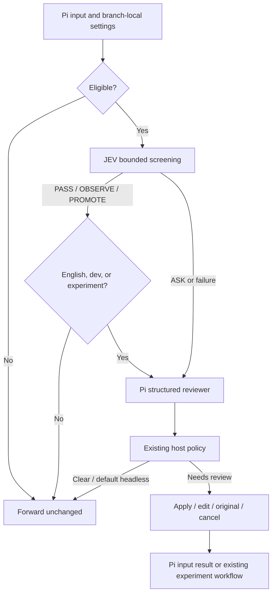

# Prompt audit: JEV screening + Pi review

The auditor is **off by default**. Run `/audit on` to screen submitted prompts
with JEV. Clear prompts pass silently. Strong findings automatically reach a
separate Pi model for detailed review. You can apply or edit its suggestion,
send the original in advisory mode, or cancel. Neither stage executes tools,
changes your executor model, or adds audit messages to its conversation.

## Setup

Set `TYPESAFE_API_KEY` in the environment that starts Pi. No JSON configuration
is required. JEV defaults to `jev-1.13.0` at TypeSafe's `/v1/systemone` endpoint.
If JEV is unavailable, Wasabi warns and uses the Pi reviewer directly.

The reviewer uses the active Pi model and credentials by default. Select a
separate configured model, including a lightweight model registered in Pi, with:

```bash
pi --no-extensions -e . --audit-model <provider>/<model-id>
```

Optional screening settings come from `~/.pi/agent/prompt-auditor.json`, or the
file selected by `PI_PROMPT_AUDITOR_CONFIG`. See
[the example](examples/prompt-auditor.json). Settings are read for each audit;
project-local files are never consulted. Invalid configuration triggers the Pi
reviewer fallback, rather than disabling the user's selected audit mode.

The standalone prototype's `mode`, `rewrite`, `policy.failure`, and
`policy.headless` fields are accepted for file compatibility but **do not control
Wasabi**. Wasabi's commands and branch-local settings control enablement;
`--audit-model` selects the reviewer; Wasabi retains its host failure policy.
There is no independent rewrite endpoint or `/audit-jev` command. Disable the
standalone extension when enabling Wasabi to avoid auditing submissions twice.

## Commands and compatibility

| Command | Behavior |
| --- | --- |
| `/audit on` | Enable advisory review |
| `/audit off` | Disable automatic auditing and raw dev capture |
| `/audit strict` | Require explicit editing for critical findings; no send-original override |
| `/audit dev` | Enable detailed review and raw, opt-in dataset capture |
| `/audit experiment` | Compare the next eligible prompt and its revision on sibling branches |
| `/audit bypass-next` | Skip the next eligible prompt |
| `/audit status` or `/audit-status` | Show mode, pending actions, JEV setup, and reviewer selection |
| `/audit-english next` | Polish the next eligible audited prompt |
| `/audit-english semantic` | Correct only meaning-changing English errors |
| `/audit-english always` | Offer routine English polishing on audited prompts |
| `/audit-english off` | Audit meaning without language correction |

English settings do not independently enable the auditor. Advisory/strict
settings and English preferences retain their existing `prompt-audit-settings`
format and follow the active branch on reload, resume, and tree navigation.
Dev capture and one-shot actions are not persisted. The registered
`extensions/prompt-audit.ts` entry remains a compatibility shim; the implementation
lives in this directory. Crop, Crunch, and LiteLLM tracking remain independently
configurable.

Blank input, slash commands (including skills/templates before expansion),
extension-generated input, and immediate steering bypass review without consuming
pending actions. Queued follow-ups are audited. Editing a reviewed prompt runs
at most one more screening/review cycle. Images remain attached to transformed
submissions. Cancellation restores the original text; Pi does not provide an
attachment-restoration API, so check attachments before resubmitting.

## Routing and limits

JEV evaluates six independent detectors in one HTTP request:
`unresolved_reference`, `missing_user_choice`, `conflicting_instructions`,
`consequential_wording`, `missing_evidence`, and `unsupported_capability`.
Probabilities estimate the presence of an issue, not severity or task success.
The [TypeSafe API](https://docs.typesafe.ai/api) documents the Noul contract.

| Screening outcome or request | Next step |
| --- | --- |
| `PASS` | Send unchanged |
| `OBSERVE` (discoverable evidence) | Send unchanged; evidence gathering belongs to the executor |
| `PROMOTE` (uncertainty or incomplete context) | Record the recommendation and send unchanged; no model switch |
| `ASK` (strong material finding) | Automatically call the Pi reviewer; only its validated report and host policy can open review |
| English `next` / `always` | Obtain language review even when JEV passes |
| Dev / experiment | Always obtain a full detailed report, including when JEV passes |
| Screening failure, including absent credentials | Warn and call the Pi reviewer |
| Reviewer failure | Warn and send the original under the default host failure policy |

The initial thresholds are 0.85 for user-choice/material findings, 0.75 for
missing evidence, and [0.35, 0.65] for uncertainty. These are uncalibrated defaults.
`APPLY_SKILL` remains a reserved action; no skills are selected or executed.

JEV has a 1,500 ms total HTTP deadline, including response delivery, a 256 KiB
response limit, and no automatic retry. Pi review retains a 15-second total
model deadline, 1,200 output tokens, a bounded input budget, and at most one JSON
repair within that deadline. A failed screening can therefore add up to its
deadline before fallback begins. These are limits, not measured latency claims.
RPC, print, and JSON modes do not open review dialogs and forward unchanged
under the existing default headless policy. Auditing grants no execution or
approval permissions.

## Context and privacy

JEV receives the verbatim prompt, bounded text from the active compaction-aware
branch, the latest summary, active tool descriptions, model identity, and any
explicitly configured conventions. Defaults allow eight recent messages,
16,000 context characters, and 24,000 prompt characters. An oversized prompt is
never silently clipped: screening fails and Pi review is attempted.

System prompt and working-directory path are excluded from JEV by default.
Project scans, tool outputs, reasoning blocks, and image pixels are excluded.
Coverage records truncation and omissions; unavailable context or unseen images
cannot by themselves force context-dependent clarification. Ordinary older
history windowing is distinguished from clipping the selected recent context.

Pi review retains Wasabi's `frontier-v1` context planning, trust checks, input
budget, and model-dependent image support. It also receives bounded screening
evidence and configured conventions, treated as untrusted evidence. The JSON
screening context controls apply to JEV; they do not change this separate Pi
review profile. Both providers receive submitted content when invoked, including
Pi fallback calls. Choosing a local reviewer does not make JEV screening local.

Normal `prompt-audit` entries retain their existing fields and add optional
`screening` metadata: scores, thresholds, routing, model identities, coverage,
usage, and timing. They contain no prompt/context text, image payloads, keys, or
provider response bodies. Screening-only passes have no fabricated detailed
findings or LLM report. Diagnostic write failures cannot block submission.

`/audit dev` retains the opt-in `prompt-audit-dev` dataset with raw prompts,
reviewer responses, normalized reports, and selected/edited text. It also records
screening metadata. Enabling it warns that this data may contain secrets; image
payloads are excluded. Returning to on, strict, or off stops raw capture.

Experiments retain the `prompt-audit-experiment` format. They execute the
non-selected alternative first and the selected alternative second on a sibling
branch, leaving the selected branch active. They require two distinct prompt
alternatives and successful raw dev recording; otherwise the comparison is
skipped and the selected normal submission proceeds. Filesystem and network side
effects are shared between branches: use read-only tasks or external isolation.
Session changes cancel stale audits and pending experiment continuations.

## Architecture and validation



The runtime adapts the standalone JEV prototype's classification and transport
layers. It deliberately retains Wasabi's Pi model selection and structured
report/UI boundary. JEV findings are routing hints; the reviewer independently
assesses confidence, severity, and materiality. This preserves strict policy
without mistaking classifier probabilities for impact scores.

```bash
npm run check
npm run audit:smoke
npm run audit:evaluate
# Optional real JEV requests, using only the synthetic fixtures:
npm run audit:evaluate -- --live
```

Checks include existing workflow regressions, mocked HTTP contracts, screening
policy, configuration, context privacy, fallback, cancellations, session changes,
and experiment completion. Smoke testing uses Pi's real loader for both the
compatibility entry and the full package. Offline evaluation validates 24 fixture
records (English, Korean, and mixed language); it does not measure model accuracy.
Live evaluation reports JEV decision agreement and latency separately. Validate
Korean and mixed-language quality on real workloads before relying on thresholds.
